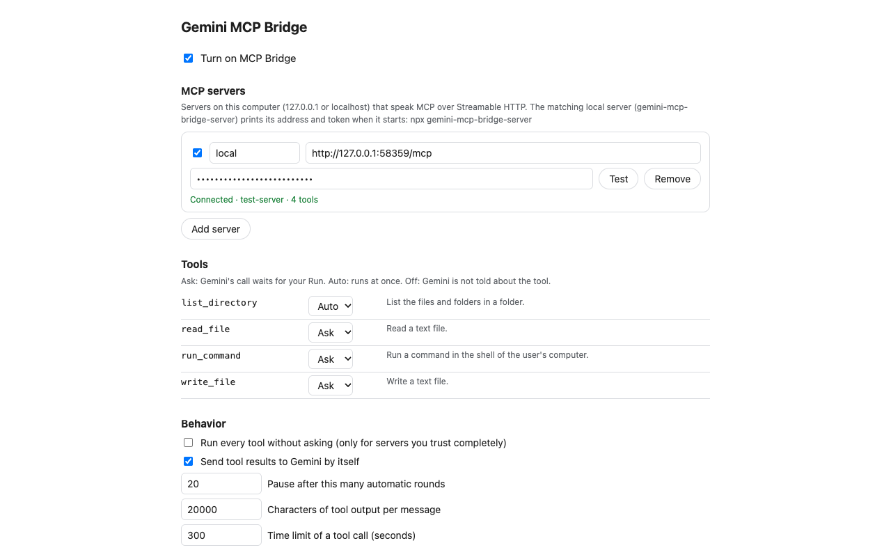
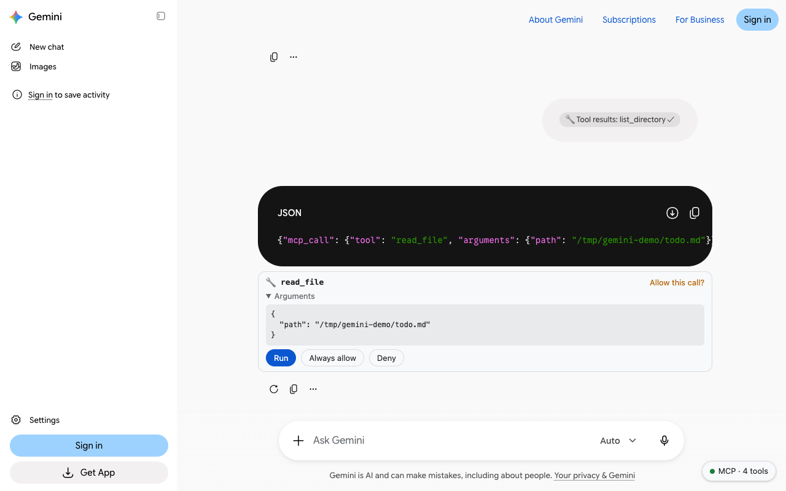

# Gemini MCP Bridge

Gemini on the web ([gemini.google.com](https://gemini.google.com), and [Gemini Enterprise](#other-chat-pages-gemini-enterprise-and-others) or other chat pages) gets the tools of your own computer: your shell, your files, and any MCP server you run. You chat as usual; when Gemini needs your computer, it calls a tool, and the answer comes back by itself.

It works only in the tabs where you turn it on: click its icon in Chrome's toolbar.

This is the Chrome extension. It works with a local MCP server, because an extension cannot touch your computer by itself:

- **[gemini-mcp-bridge-server](https://github.com/somebodil/gemini-mcp-bridge-server)**, the matching server: shell and file tools, plus any MCP servers you list. Start it with `npx gemini-mcp-bridge-server`.
- **Any other MCP server** on `127.0.0.1` or `localhost` that speaks Streamable HTTP.

## How it works

Gemini on the web has no API for outside tools, so the extension works through the chat itself:

0. You click the extension's icon in the tab where you chat. The extension goes into that tab only (the icon shows **ON** there); another click takes it out.
1. When you send the first message of a conversation, the extension puts instructions and the list of your tools in front of it. On the page they collapse into a chip: `🔧 MCP Bridge instructions · 4 tools`.
2. When Gemini needs a tool, it answers with a code block like this one, and stops:

   ```json
   {"mcp_call": {"tool": "read_file", "arguments": {"path": "~/notes/todo.md"}}}
   ```

3. The extension shows a card under the block. It runs the call when you press **Run**, or at once for tools you allowed. The call goes to the MCP server on your computer.
4. The extension types the results into the input box and sends them. On the page they collapse into a chip too. Gemini continues: it calls more tools or answers you.

Gemini does not know an extension exists. It follows the instructions in the conversation, as it would follow any other instructions.

## Install

The extension is not in the Chrome Web Store: you install it from a release, by hand. It takes about five minutes.

### 1. Start the local server

You need Node.js 20 or later. Check in a terminal:

```bash
node --version
```

No `node`, or a version under 20: install the LTS version from [nodejs.org](https://nodejs.org).

Then start the server:

```bash
npx gemini-mcp-bridge-server
```

The first start makes a config file with a random token and prints what the extension needs:

```
gemini-mcp-bridge-server 0.2.0
  URL:    http://127.0.0.1:7341/mcp
  Token:  3q2-...
  Config: /home/you/.config/gemini-mcp-bridge-server/config.json (new)
  Tools:  run_command, read_file, write_file, list_directory
```

Leave this window open while you use Gemini: the server runs as long as the window does, and every call shows up there.

To have the server start by itself whenever you log in, install it once and register it (macOS, Linux and Windows, no administrator rights):

```bash
npm install -g gemini-mcp-bridge-server
gemini-mcp-bridge-server install-service
```

More about the server: [gemini-mcp-bridge-server](https://github.com/somebodil/gemini-mcp-bridge-server#readme).

### 2. Add the extension to Chrome

1. Open the [latest release](https://github.com/somebodil/gemini-mcp-bridge/releases/latest) and download `gemini-mcp-bridge-extension-<version>.zip` (under **Assets**).
2. Unzip it into a folder that stays where it is, for example `Documents/gemini-mcp-bridge`. Chrome loads the extension from this folder every time it starts: do not delete or move it.
3. Open `chrome://extensions` (type it into the address bar).
4. Turn on **Developer mode** (the switch at the top right).
5. Click **Load unpacked** (top left) and choose the folder from step 2: the one that holds `manifest.json`.
6. *Gemini MCP Bridge* appears in the list, and its options page opens.
7. Click the puzzle icon in Chrome's toolbar and pin *Gemini MCP Bridge*: you turn it on with its icon.

### 3. Connect the extension to the server

On the options page (later: right-click the extension's icon, then **Options**; or **Settings** in the corner button):

1. Leave the URL as it is (`http://127.0.0.1:7341/mcp`), unless you started the server with another port.
2. Paste the token the server printed. Lost it? Run `gemini-mcp-bridge-server token` (or `npx gemini-mcp-bridge-server token`).
3. Press **Test**. It should say *Connected · gemini-mcp-bridge-server · 4 tools*, and list the tools below.



### 4. Use it

Open [Gemini](https://gemini.google.com/app) and click the extension's icon: **ON** appears on it, and a button in the lower right corner of the page. Start a new chat, and ask something that needs your computer, for example *"What are the largest files in my Downloads folder?"*.

- The button in the corner shows the state (*MCP · 4 tools*). Click it to see the servers, to turn the tools off for this chat, or to turn the extension off in this tab. Drag it elsewhere if it covers something; it keeps the place for the site.
- The extension stays on in the tab when you reload the page. It goes off when you click the icon again, when the tab goes to another site, or when you close the tab. Other tabs are not touched.
- Each call gets a card under it. Press **Run** to run it, **Always allow here** to let that tool run without asking from now on on this site, or **Deny**.
- While a message is on its way, a line above the corner button says where it is: the page is writing the reply, the reply has calls, waiting for your **Run**, running, sending the results, done. A smaller line says what went along with your message (the tool instructions, the results). When no reply is found, the line says so, and what you can do.



### Other chat pages (Gemini Enterprise and others)

On a page other than gemini.google.com, for example Gemini Enterprise (`vertexaisearch.cloud.google.com`), the extension runs in **generic mode**. It does not know the page: it learns it from one test message, or it guesses.

**Learn the page** (once per site). Click the corner button, then **Learn this page**:

1. Click the input box: a test message goes in. It asks for one short JSON code block back.
2. Send it, with the send button or Enter (Ctrl+Enter on a page that sends that way: the extension then leaves Enter alone there and sends with Ctrl+Enter too). Meanwhile the extension only watches: nothing goes along with the message, and no tool runs.
3. A list of steps fills in as the extension sees each part: the input box, the send button, what shows that the page is writing (most often a stop button), your message, the reply, and the code block in it. When everything was seen, press **Stop learning**.
4. The extension lists what it learned and outlines each part on the page: ✓ sure, ? a guess, ✗ not found. If a part is wrong, press **Pick** beside it and click the right element on the page: ↑ goes one layer out, ↓ back in, ← and → go to the element before and after it in the same layer, Enter picks, Esc cancels. The **?** beside it shows a table of what to pick for each part. Or press **Learn again**.

What it learned is kept for the site (its address without the path) and used in every tab of it. The options page lists the learned sites; delete one to go back to guessing there.

**Not learned,** the extension guesses: the input box is the box you type in, the send and stop buttons are found by their names (*Send*, *Submit*, *Stop*, *보내기*, *중지*), and a tool call is a code block that appears after your message went out (also inside web components).

Either way:

- Code blocks that were on the page before, or that are part of your own message, never run.
- The instructions are sent again when they are not on the page, for example in a new chat at the same address.
- There are no chips: the instructions and results stay visible as the page shows them.

If it does not work on a page even after learning, click the corner button, then **Copy page structure**, and paste it into an [issue](https://github.com/somebodil/gemini-mcp-bridge/issues). It holds the page's element names, classes and labels, and the length of texts, but none of the texts themselves. Look it over before you post it: labels can hold the titles of your chats.

## Update

A new version does not install itself:

1. Download the new zip from the [latest release](https://github.com/somebodil/gemini-mcp-bridge/releases/latest).
2. Unzip it over the same folder (replace the files).
3. In `chrome://extensions`, press the reload button (the round arrow) on *Gemini MCP Bridge*.
4. Click the icon again in the tabs where you use it (an update turns the extension off in all tabs).

Your settings stay. The server updates the same way it was installed: `npx` takes the latest version by itself; after `npm install -g`, run it again.

## Uninstall

- The extension: **Remove** on its card in `chrome://extensions`, then delete its folder.
- The server: `gemini-mcp-bridge-server uninstall-service` if you registered it, `npm uninstall -g gemini-mcp-bridge-server` if you installed it, and delete its config file (the path is in its first lines of output) to forget the token.

## Troubleshooting

| What you see | What to do |
|---|---|
| *Cannot reach http://127.0.0.1:7341/mcp ... Is the local server running?* | Start the server (step 1), then press **Test** or **Refresh**. |
| *HTTP 401 ... Check the token* | The token in the options does not match the server's: paste it again (`gemini-mcp-bridge-server token`). |
| *Only 127.0.0.1 and localhost addresses can be reached* | The extension talks only to servers on your own computer. |
| No corner button on the page | The extension is off in this tab: click its icon (it shows **ON** when on). After an update of the extension, every tab starts off. |
| The icon does nothing on a page | Chrome does not let extensions into some pages (`chrome://` pages, the Chrome Web Store). |
| On a page other than gemini.google.com, nothing happens | Learn the page: corner button, then **Learn this page** (see [Other chat pages](#other-chat-pages-gemini-enterprise-and-others)). If it still does not work, copy the page structure and open an issue. |
| *No reply found yet* on a learned page | The page changed since it was learned: press **Learn again** on that line. |
| Gemini says it cannot access your computer | Start a new chat: the instructions go with the first message of a chat. Check that the corner button is there and shows tools, and not *Off*. |
| Gemini writes a call, but nothing happens | Look at the card under it: it may be waiting for **Run**. A call in a chat opened from the history never runs: only replies written while the page is open do. |
| A call ends in an error, or a command does something other than in your terminal | Open DevTools (F12) on the chat page: the console shows each failed call (`[MCP Bridge] ... failed`) with the error and the arguments sent, and each call it could not read with what Gemini wrote. The service worker's console (`chrome://extensions`, MCP Bridge, *service worker*) shows the same, and gemini-mcp-bridge-server prints `call ... → error: ...`. The card shows the arguments as the tool gets them: a command copied from it runs the same in a terminal. |
| The extension disappeared after Chrome restarted | Its folder was moved or deleted: unzip it again and **Load unpacked** again. |
| The page is slow with the extension on | Turn on the **Performance log** in the options, use the page as usual for a few minutes, and copy the lines into an issue. They say how long the slow clicks, keys and frames took and how much of each was the extension's own work. |

## Safety

Read this before you allow a tool to run by itself.

- **Only where you turn it on.** The extension can see a page only after you click its icon in that tab (Chrome's *activeTab*). It has no access to any site by itself.
- **Calls wait for you.** By default every call waits for your **Run**. *Always allow here* (or *Auto* on the options page) lets one tool run without asking, only on the sites listed for it (the site where you pressed it; Gemini when you chose *Auto* on the options page); on every other site the tool still waits for your **Run**. There is no switch that lets every tool run.
- **Gemini's text is not trustworthy.** A web page, a document or an email that Gemini reads can carry instructions of its own ("prompt injection"). Keep tools that run commands or write files on **Ask** unless you watch closely.
- **Old conversations never run calls.** A reply is handled only if this tab saw Gemini write it. Opening an old chat, reloading the page or switching chats runs nothing.
- **Local only.** The extension may reach only `127.0.0.1` and `localhost`.
- **What Google sees.** The instructions, the tool list and every tool result become messages of your Gemini conversation. Google stores and uses them like everything else you type into Gemini. Do not let Gemini read files you would not paste into Gemini yourself.

## Options

- **MCP servers:** any number of them, each with a URL and an optional token (sent as `Authorization: Bearer`). If two servers have a tool of the same name, the server's name goes in front of it.
- **Tools:** *Ask*, *Auto* or *Off* for each tool. Gemini is not told about tools that are off.
    - Under an *Auto* tool, the sites where it runs without asking, one regular expression per line. A pattern has to match the whole address of the site (scheme, host and port, no path), case aside: `https://gemini\.google\.com`, `https://(chat|www)\.example\.com`, `http://127\.0\.0\.1:\d+`. `gemini\.google\.com` alone matches nothing (no `https://`), and `.*` matches every site.
    - **Check** says which lines are not regular expressions and why, which lines match any site, which have a plain `.` (it matches any character, so `https://gemini.google.com` matches `https://gemini-google.com` too: write `\.`), and which line matches the address in *Address to try the patterns on*. The list is saved when you leave the box, and only when every line is a regular expression. With no line, the tool is asked about everywhere. Setting the tool to *Ask* or *Off* forgets its sites.
- **Behavior:**
    - Send the results by itself, or leave them in the input box.
    - How many characters of output go into one message (20,000 by default).
    - The time limit of a call.
- **Learned pages:** the chat pages learned in generic mode, each with when it was learned and which parts were found or picked by hand. Delete one to go back to guessing on it.
- **Performance log** (off by default): to find out why a page is slow. In the tabs where the extension is on, it writes down
    - each click or key that took 100 ms or more to show its effect (what Chrome's *Interaction to Next Paint* measures), each frame of 150 ms or more, and how much of that time was the extension's own work;
    - every minute, how much time the extension took and in which of its functions.

  The lines carry names and numbers only (the site without its path, the tag and classes of the element clicked, the hosts and file names of the page's slow scripts), no text of the page. The last ones stay on the options page, with **Copy** and **Clear**, until the browser closes. When gemini-mcp-bridge-server is connected, it appends them to its `perf.log` too (`gemini-mcp-bridge-server perf-log` shows them).

## Limits

- The extension reads and writes Gemini's page, which Google can change at any time. When Gemini changes its page, the extension may stop working until it is updated. All of what it relies on is in [`src/content/gemini.ts`](src/content/gemini.ts); for other pages, in [`src/content/generic.ts`](src/content/generic.ts).
- Generic mode without learning guesses: a page whose send button has no name, or that shows code blocks without `<pre>`, `<code>` or a monospace font, needs to be learned. A learned page that changes how it looks needs to be learned again; the status line says so when it finds no reply. How a page is learned is in [`src/content/learn.ts`](src/content/learn.ts) and [`src/content/layout.ts`](src/content/layout.ts).
- Gemini follows the protocol well, but it is a protocol in text: now and then Gemini writes a call in the wrong shape, or forgets the instructions in a very long conversation. A call it cannot read gets an error back, so that Gemini can write it again. When the tool list changes, the next message carries the new list.
- Images, audio and other binary output of tools reach Gemini only as a short note (`[image: image/png, 120 KB, not shown]`).
- Only Chrome. Only the top frame of a page (not a chat inside an iframe).

## Privacy

The extension sends nothing to its developer or to anyone else: see [PRIVACY.md](PRIVACY.md).

## Development

```bash
npm install
npm run check     # types, lint, unit tests (the MCP client against servers made with the official SDK)
npm run build     # dist/extension: load it with "Load unpacked"
npm run e2e       # a test build in Chromium against a mock of Gemini's page and two mocks of other chat pages, built unlike each other
npm run e2e:live  # against the real gemini.google.com, signed out (also as an unknown page, learned first)
node e2e/obey.ts  # how often each Gemini model follows the instructions (after changing their wording)
```

With `localStorage["gmb-debug"] = "1"` on the page, the extension writes its steps to the console (failed calls and unreadable ones are written there always). With `localStorage["gmb-generic"] = "1"`, it uses generic mode on gemini.google.com too.

A release: set the version in `package.json` (the build writes it into the manifest), then push a tag with that version. The workflow builds the zip, attests it, and creates the release.

`store/` holds what a Chrome Web Store listing would need (texts, screenshots, the promo tile), for the day the extension goes there.

## License

MIT
